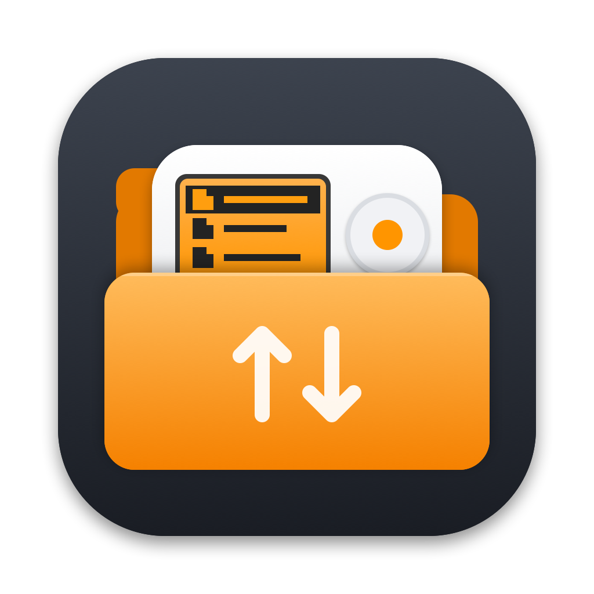

<p align="center"></p>

<h1 align="center">FlipperFiles</h1>

<p align="center">Нативный файловый менеджер для <b>Flipper Zero</b> по USB для macOS (Apple Silicon).</p>

<p align="center">
  <a href="../../releases/latest"><b>⬇️ Скачать последнюю сборку</b></a>
</p>

---

## Возможности

- 🔌 Автопоиск Flipper (`/dev/cu.usbmodemflip*`), подключение и отключение в один клик
- 📂 Обзор SD-карты `/ext` и внутренней памяти `/int`, переход по папкам
- ⬇️ Скачивание файлов и папок на Mac
- ⬆️ Загрузка файлов и папок с Mac: кнопкой или перетаскиванием в окно
- ✏️ Создание файлов и папок, переименование, удаление (папки удаляются вместе с содержимым)
- 📝 Встроенный текстовый редактор: сохранение прямо на Flipper (⌘S)
- 🖥 Консоль с логом обмена и полоса прогресса передачи
- 🧯 Ошибки показываются алертом; при отключении кабеля состояние корректно сбрасывается

## Требования

- macOS 14 Sonoma или новее, Apple Silicon (arm64)
- Flipper Zero, подключённый по USB. qFlipper и другие программы, занимающие порт, нужно закрыть

## Установка

1. Скачайте `FlipperFiles-macOS-arm64.zip` со страницы [Releases](../../releases/latest) и распакуйте.
2. Перенесите `FlipperFiles.app` в «Программы».
3. Приложение подписано ad-hoc (без Apple Developer ID), поэтому при первом запуске macOS может его заблокировать. Чтобы снять блокировку, выполните:
   ```bash
   xattr -dr com.apple.quarantine /Applications/FlipperFiles.app
   ```
   Или откройте его через правый клик → «Открыть».

## Сборка из исходников

Нужны Xcode Command Line Tools (Swift 5.9+). Сторонних зависимостей нет.

```bash
git clone https://github.com/2p4g0/FlipperFiles.git
cd FlipperFiles
./build.sh
```

Готовое `FlipperFiles.app` появится в корне проекта. Иконка генерируется скриптом `Tools/make_icon.swift`.

## Как это работает

Приложение общается с командной строкой Flipper (CLI) через последовательный порт (POSIX `termios`, 230400 8N1). Весь ввод-вывод идёт в отдельном Swift `actor`, поэтому интерфейс не подвисает.

| Действие | Команда Flipper CLI |
|---|---|
| Список файлов | `storage list` |
| Чтение файла | `storage read_chunks <path> 512` |
| Запись файла | `storage remove` + `storage write_chunk <path> <n>` |
| Папка / переименование / удаление | `storage mkdir` / `storage rename` / `storage remove` |

Блочная передача (`read_chunks` / `write_chunk`) передаёт бинарные файлы без искажений.

## Структура

```
Sources/FlipperFiles/
  FlipperSerial.swift   — работа с портом и протокол CLI (actor)
  Model.swift           — состояние приложения и операции
  Views.swift           — интерфейс SwiftUI
Tools/make_icon.swift   — генератор иконки
build.sh                — сборка, упаковка в .app, ad-hoc подпись
```

## Благодарности

Протокол взят из веб-версии [dagnazty/flipperusb](https://github.com/dagnazty/flipperusb).

Flipper Zero — торговая марка Flipper Devices Inc. Проект неофициальный и с Flipper Devices не связан.
